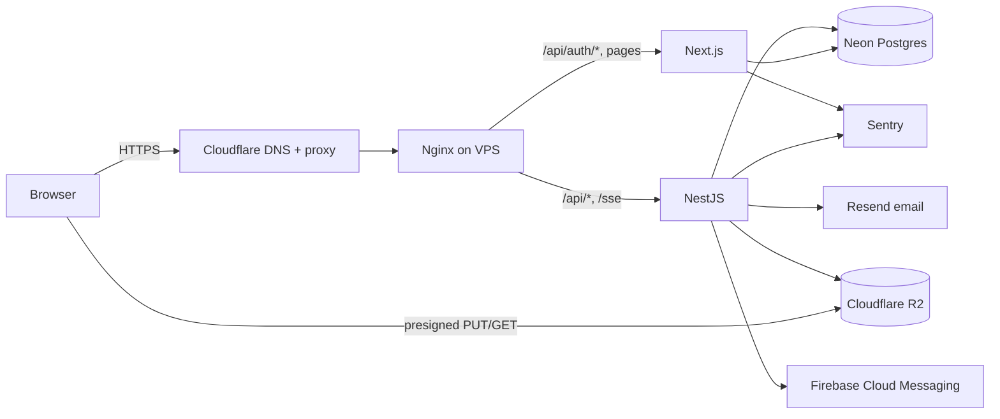
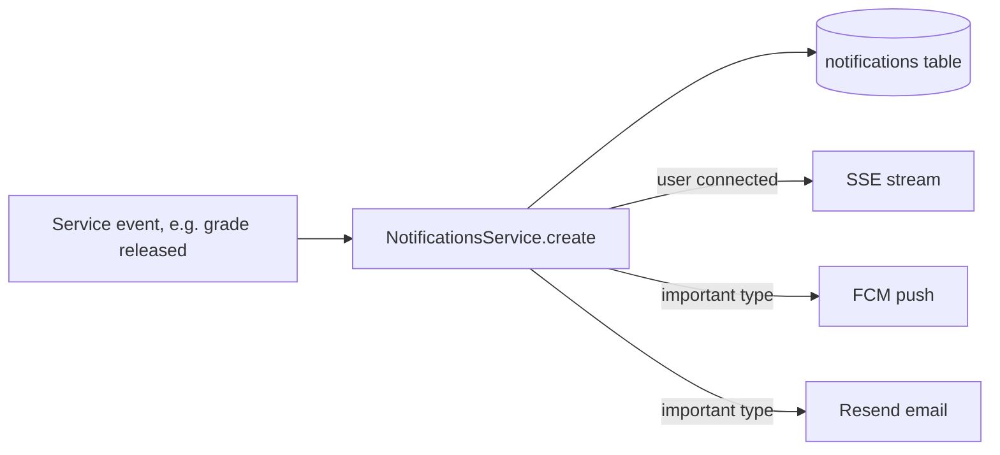

# System design

## 1. Architecture

A modular monolith: one Next.js app and one NestJS app, behind Nginx on one VPS. Everything stateful lives in managed services.



- **Next.js** renders pages and hosts the Better Auth route handler (`/api/auth/*`).
- **NestJS** holds all business logic and authorization. It validates sessions with the shared Better Auth instance.
- Both use one Prisma client from `packages/database`.
- File bytes never pass through the VPS: browsers upload to and download from R2 directly.

## 2. Tenancy

- **Model:** shared database, `tenant_id` on every tenant-owned table.
- **Resolution:** from `Host`. `drahmed.<root-domain>` → `tenants.slug = 'drahmed'`. `admin.<root-domain>` is the super admin site.
- **Enforcement:** a Prisma client extension injects `tenant_id` into every query on tenant-owned models. The tenant comes from request context (AsyncLocalStorage), never from the client.
- **Later:** Postgres RLS as a second lock. Custom domains through Cloudflare for SaaS.
- **Identity:** `users` are global (one per email). `memberships` link a user to a tenant with a role and status.
- **Sessions:** cookies are host-only, so each tenant subdomain has its own session. The device cookie is set on the parent domain so a device is recognized across tenants (see ADR-004).

## 3. Request pipeline (NestJS guards, in order)

1. **Tenant:** resolve the tenant from the host; 404 if unknown or deleted.
2. **Session:** Better Auth session is valid.
3. **Access status:** user not suspended; membership active; membership role not in `tenant.paused_roles`.
4. **Device (students):** device cookie matches an active device of this user, and matches `session.device_id`.
5. **Role and permission:** the role allows this action (SRS §2).
6. **Resource:** enrollment, file, quiz or attempt checks belong to the service.

Failures return 401/403 with a machine-readable `reason` (`DEVICE_NOT_REGISTERED`, `SESSION_ON_OTHER_DEVICE`, `TENANT_PAUSED`, …) that the frontend shows in the user's language.

## 4. Storage

| What | Where | Access |
|---|---|---|
| Course files, videos | R2 bucket `private`, key `tenants/{tenantId}/{assetId}` | Presigned GET after checks |
| Logos, thumbnails, hero images | R2 bucket `public`, key `tenants/{tenantId}/…` | Public URL via Cloudflare |
| Metadata | `media_assets` table | — |

- **Upload:** client asks the API → API checks role, type and size limits → returns a presigned PUT (15 min) → client uploads → client calls `confirm` → API checks the object with `HEAD` and marks the asset `ready`.
- **Download/view:** presigned GET. Documents: 5 min. Videos: 4 hours (range requests continue during playback); the player asks for a new URL on 403.
- **Videos:** MP4 (H.264/AAC), 720p recommended. A moving CSS watermark shows the student's name and email.
- **Usage:** storage per tenant = `SUM(media_assets.file_size)`. No counter tables.

## 5. Notifications



- SSE endpoint `GET /api/sse`: one stream per tab, held in an in-memory `Map<userId, Set<stream>>`. One API instance is assumed; Redis pub/sub is needed only with more than one.
- SSE also carries control events: `session_revoked`, `device_revoked`, `enrollment_terminated`.
- Push tokens are stored per device and deleted when the device is revoked.
- Nginx: `proxy_buffering off` and a long read timeout on `/api/sse`.

## 6. Scheduled jobs (`@nestjs/schedule`)

| Job | Every |
|---|---|
| Delete expired invitations and sessions | 1 hour |
| Release grades for quizzes past close time (release modes 2 and 3) | 1 minute |
| Purge tenants soft-deleted more than 30 days ago (DB rows and R2 prefix) | 1 day |

Jobs are idempotent. They are never the only authority: exam windows and grade visibility are also checked on every read.

## 7. Deployment

```text
Hostinger VPS (Docker Compose)
  nginx    TLS from Cloudflare origin cert; routes by path
  web      Next.js (standalone build)
  api      NestJS
External: Neon (prod + staging branch), R2, Resend, FCM, Sentry, uptime monitor
```

- **Environments:** `staging` (Neon branch, separate compose stack, `*.staging.<root-domain>`) and `production`.
- **DNS:** wildcard `*.<root-domain>` proxied by Cloudflare.
- **Email:** SPF, DKIM and DMARC on the sending domain. Emails show the tenant's name as the sender name.
- **Backups:** Neon point-in-time restore plus a nightly `pg_dump` to a separate R2 bucket. Restore tested monthly.
- **CI:** GitHub Actions: lint, typecheck, tests, build images. Deploy by hand at first.

## 8. Scaling path (do not build now)

| Trigger | Add |
|---|---|
| More than one API instance | Redis pub/sub for SSE fan-out |
| Bulk email or imports slow requests | BullMQ worker |
| Video quality or leak complaints | Bunny Stream (swap the `media_assets.provider`) |
| Teachers want their own domains | Cloudflare for SaaS custom hostnames |
| Native app planned | Hardware device ID in place of the cookie |
