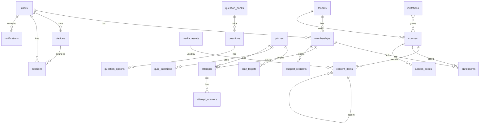

# Database

Neon PostgreSQL with Prisma. UUID primary keys, UTC `timestamptz`, `created_at`/`updated_at` on all tables. Tables marked **T** carry `tenant_id` and are auto-scoped by the Prisma extension. Better Auth owns `user`, `session`, `account`, `verification`, `two_factor`; we extend `user` and `session`.

## ERD (core)

## Tables

### Platform and identity
| Table | Key columns | Notes |
|---|---|---|
| `tenants` | slug (unique), name, status (`active`/`deleted`), paused_roles `text[]`, settings `jsonb`, deleted_at | Settings validated by a Zod schema (`TenantSettingsSchema`, step 7.11): branding (logo/favicon asset ids, colors), hero, pages (sanitized HTML), contact, social links (https), locale (`ar` default), timezone (`Africa/Cairo` default), defaultMaxDevices (1–5, used for new student accounts). `{}` reads as all defaults. |
| `users` (Better Auth) | email (unique), name, email_verified, + `max_devices int default 1`, `status` (`active`/`suspended`), `is_super_admin bool` | Global identity. |
| `sessions` (Better Auth) | token, user_id, expires_at, + `device_id`, `tenant_id` | Host-only cookie. Global, not tenant-filtered: `tenant_id` records the subdomain the session was opened on, and the one-session rule reads a student's sessions on every tenant. `device_id` is null for staff and super admin sessions; `tenant_id` is null on the super admin host. |
| `memberships` **T** | user_id, role (`teacher`/`assistant`/`student`), status (`active`/`suspended`), guardian_consent_at, phone | Unique (tenant_id, user_id). |

### Devices and support
| Table | Key columns | Notes |
|---|---|---|
| `devices` | user_id, name, user_agent, fingerprint_hint, status (`active`/`pending`/`revoked`), secret_hash, last_seen_at, revoked_at | Global (not per tenant). One secret per device; rotating replaces the hash. |
| `push_tokens` | user_id, device_id, token (unique) | Deleted when the device is revoked. |
| `support_requests` **T** | membership_id, type (`device_change`/`sign_out_other`/`general`), status (`open`/`approved`/`rejected`/`closed`), message, pending_device_id, decided_by, decided_at | Device requests and general support in one table. |

### Access and money
| Table | Key columns | Notes |
|---|---|---|
| `invitations` **T** | email, token_hash (unique), course_ids `uuid[]`, expires_at, redeemed_at, redeemed_by, revoked_at, created_by | 72 h, single use. |
| `access_codes` **T** | course_id, code_hash (unique), batch_id, redeemed_by, redeemed_at, revoked_at | HMAC-SHA256 of the code with a server secret. |
| `enrollments` **T** | membership_id, course_id, status (`active`/`terminated`), source (`invitation`/`code`/`manual`), granted_by, terminated_by, terminated_at | Unique (membership_id, course_id). |
| `payments` **T** | membership_id, course_id (nullable), amount (numeric), currency, paid_at, method, note, recorded_by | Records only; no gateway. |

### Content
| Table | Key columns | Notes |
|---|---|---|
| `courses` **T** | title, description, thumbnail_asset_id, status (`draft`/`published`/`archived`), deleted_at | |
| `content_items` **T** | course_id, parent_id, kind (`folder`/`chapter`/`lecture`/`file`/`video`; `quiz` in Phase 8), title, sort_order, depth, asset_id, quiz_id (Phase 8), published_at, deleted_at | Adjacency list; depth 1–5. Rules: [designs/phase-7.4](designs/phase-7.4-content-tree-api.md). |
| `media_assets` **T** | provider (`r2`), purpose (`content`/`public`), storage_key, original_name, mime_type, file_size (bigint), duration_sec, status (`pending`/`ready`/`failed`), download_policy (`view_only`/`downloadable`), uploaded_by | Provider column allows Bunny later. `purpose` picks the bucket: `content` = private, `public` = public (images only). Deleting a user who uploaded files is refused. |
| `lesson_progress` **T** | membership_id, content_item_id, completed_at, video_position_sec, updated_at | Unique (membership_id, content_item_id). File and video items only. The resume point is the latest `updated_at` that is not completed. Kept when an enrollment ends. |
| `comments` **T** | content_item_id, author_membership_id, parent_id, body, hidden_at, deleted_at | Lesson Q&A. |

### Exams
| Table | Key columns | Notes |
|---|---|---|
| `question_banks` **T** | course_id (null = global), title | |
| `questions` **T** | bank_id, type (`single`/`multiple`/`true_false`), text, image_asset_id, marks, difficulty, explanation, tags `text[]`, deleted_at | Edits never touch attempts (snapshots). |
| `question_options` **T** | question_id, text, is_correct, sort_order | |
| `quizzes` **T** | course_id, title, opens_at, closes_at, duration_min, max_attempts, pass_mark, selection (`manual`/`random`), random_count, random_bank_ids `uuid[]`, shuffle_questions, shuffle_options, navigation (`free`/`linear`), grace_sec, grade_release (`on_submit`/`all_submitted`/`on_close`/`manual`), review_mode (`grade`/`grade_answers`/`full`), review_release_at, grades_released_at, published_at | |
| `quiz_targets` **T** | quiz_id, content_item_id | Course, chapter or lecture nodes. |
| `quiz_questions` **T** | quiz_id, question_id, sort_order | Manual selection only. |
| `attempts` **T** | quiz_id, membership_id, device_id, started_at, deadline_at, submitted_at, snapshot `jsonb`, score, max_score, passed, extra_time_sec | Snapshot holds questions and options as served. Unique (quiz_id, membership_id, attempt_no). |
| `attempt_answers` **T** | attempt_id, question_id, selected_option_ids `uuid[]`, is_correct, marks_awarded, saved_at | Upserted by autosave. |

### Communication and audit
| Table | Key columns | Notes |
|---|---|---|
| `announcements` **T** | course_id (nullable), title, body, published_at, created_by | Creates notifications on publish. |
| `notifications` **T** | user_id, type, title, body, data `jsonb`, read_at | Index (user_id, read_at). |
| `audit_logs` **T** | actor_user_id, action, target_type, target_id, meta `jsonb`, ip, user_agent | Append-only: a Postgres trigger rejects every UPDATE; rows are deleted only by the tenant purge cascade. Written through `AuditService` (tenant, ip, user agent from the request; secret-looking `meta` keys redacted). Super admin entries use `tenant_id` null. |

## Rules
- Soft delete (`deleted_at`) for courses, content items, questions and tenants. Everything else is hard-deleted or status-changed.
- Answers are never selected into student-facing queries; student DTOs are built from attempt snapshots with `is_correct` stripped until review release.
- Migrations: `prisma migrate dev` locally, `prisma migrate deploy` in CI against the direct (unpooled) Neon URL. App uses the pooled URL.
