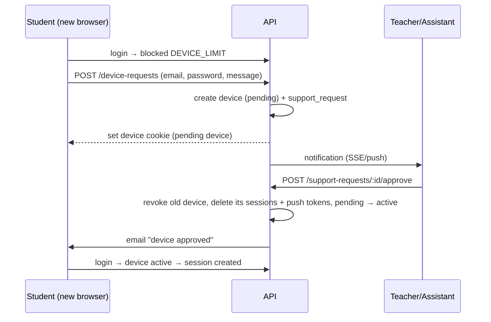

# Auth, devices and sessions

## 1. Pieces

| Piece | Owner | Stored |
|---|---|---|
| Identity, password, email verification, reset, TOTP | Better Auth | `user`, `account`, `verification`, `two_factor` |
| Session | Better Auth (+ our `device_id`, `tenant_id`) | `session`, host-only cookie |
| Device | Our `devices` module | `devices`, cookie `__Secure-lms_device` |
| Access status | Our guards | `users.status`, `memberships.status`, `tenants.paused_roles` |

**Better Auth config:** email+password, `requireEmailVerification: true`, `twoFactor` plugin, database sessions with no cookie cache (so revocation applies at once), `expiresIn` 30 days, `updateAge` 1 day. Check the current docs for exact option names.

## 2. Device cookie

```text
__Secure-lms_device = <deviceId>.<secret>
Domain=.<root-domain>; Path=/; HttpOnly; Secure; SameSite=Lax; Max-Age=400 days
```

- `secret` = 32 random bytes (`crypto.randomBytes`), base64url. DB stores `sha256(secret)`; compare with `timingSafeEqual`.
- The parent-domain cookie lets one laptop count as one device across all tenant subdomains.
- On the Vercel preview the cookie is host-only (no `Domain`), because `vercel.app` cannot hold a parent-domain cookie (ADR-009).
- Shortcut: custom domains (later) cannot share this cookie, so a device would bind per domain there. Revisit when custom domains ship.

## 3. Student login algorithm

Runs inside the sign-in flow before the session is created (Better Auth hook or a custom sign-in endpoint; check which the current version supports).

```text
1. Password OK (Better Auth).
2. Load user, membership in this tenant, tenant.
   - user.status = suspended            → block USER_SUSPENDED
   - no membership / membership suspended → block NO_ACCESS
   - membership.role in paused_roles    → block TENANT_PAUSED
3. Staff or super admin → create session, done (no device rules).
4. BEGIN; SELECT … FROM users WHERE id = $1 FOR UPDATE;
5. device = device from cookie, if it belongs to this user and is active.
6. If no device:
     active_count < user.max_devices → create device (active), set cookie
     else                             → ROLLBACK; block DEVICE_LIMIT
7. If an unexpired session exists with device_id ≠ device.id → ROLLBACK; block SESSION_ON_OTHER_DEVICE
8. Create session with device_id and tenant_id; update device.last_seen_at. COMMIT.
```

Same device, another tenant subdomain: allowed (step 7 only blocks other devices).

## 4. Blocked screens

| Reason | Message | Action |
|---|---|---|
| `DEVICE_LIMIT` | "This account is linked to another device." | **Request device change** |
| `SESSION_ON_OTHER_DEVICE` | "Your account is signed in on another device. Sign out there first." | **Request sign-out of other device** |
| `TENANT_PAUSED` | "This platform is temporarily unavailable." | — |
| `USER_SUSPENDED` / `NO_ACCESS` | "Your account is not active here. Contact your teacher." | Contact links from tenant settings |

Both request actions need the password again (the student is not logged in) and are rate-limited.

## 5. Device change request



Approval is tied to the browser that asked, so nobody else can take the slot during the wait.

## 6. Sign-out-other-device request

Same shape: the student asks from the blocked screen → staff approve → the API deletes the sessions on the other device and sends `session_revoked` over SSE. The device stays registered.

## 7. Staff and super admin actions (all audited)

| Action | Effect |
|---|---|
| Revoke device | Device `revoked`, its sessions and push tokens deleted, SSE `device_revoked`. |
| Force sign-out | All user sessions deleted, SSE `session_revoked`. |
| Change `max_devices` | Updates the user; never auto-revokes. |
| Suspend membership | Membership `suspended`, the user's sessions on that tenant deleted. |
| Pause roles (super admin) | `tenants.paused_roles` updated, sessions of those roles in that tenant deleted. |
| Suspend user (super admin) | `users.status = suspended`, all sessions deleted. |

## 8. Every authenticated request

Guards from [03-system-design.md §3](03-system-design.md). For students: the device cookie must match `session.device_id` and that device must be `active`. A copied session cookie without the device cookie fails.

## 9. Exams and devices

- An attempt stores `device_id`. Answers and submit from another device are rejected.
- If a device dies mid-exam: staff approve the new device, then use **Extend attempt time** and **Move attempt to current device** (both audited).

## 10. Rate limits (`@nestjs/throttler` + Better Auth limits)

| Endpoint | Limit |
|---|---|
| Sign-in | 5 / min per IP+email |
| Password reset, verification email | 3 / 15 min per email |
| Code redemption | 5 / 15 min per user and per IP |
| Invitation check | 10 / min per IP |
| Device and sign-out requests | 3 / hour per user |
