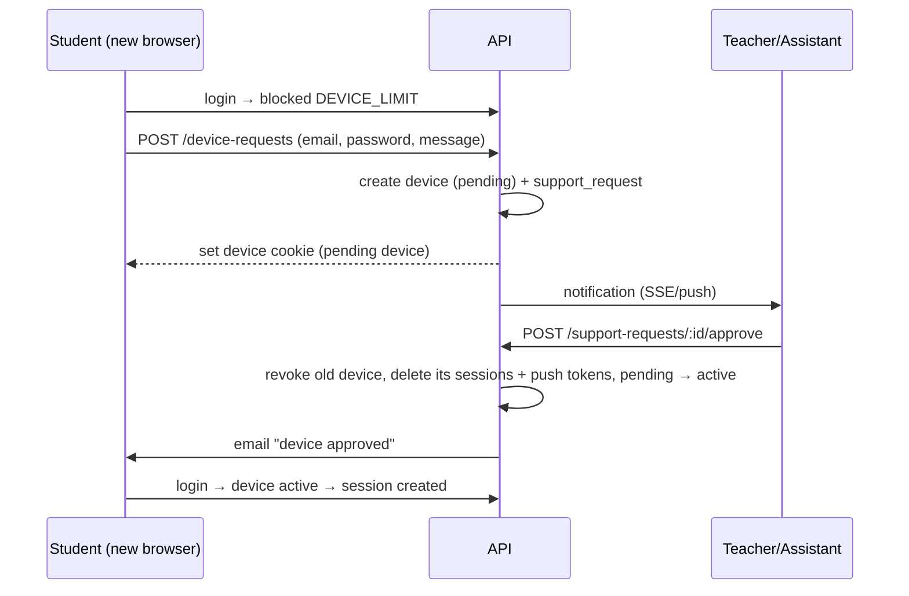

# Auth, devices and sessions

## 1. Pieces

| Piece | Owner | Stored |
|---|---|---|
| Identity, password, email verification, reset | Better Auth | `user`, `account`, `verification` |
| Session | Better Auth (+ our `device_id`, `tenant_id`) | `session`, host-only cookie |
| Device | Our `devices` module | `devices`, cookie `__Secure-lms_device` |
| Access status | Our guards | `users.status`, `users.must_change_password`, `memberships.status`, `tenants.paused_roles` |
| Password rules, sign-in audit | Our Better Auth plugin (replaces `staffMfaPlugin`) | `audit_logs` |

**Better Auth config:** email+password, database sessions with no cookie cache (so revocation and flag changes apply at once), `expiresIn` 30 days, `updateAge` 1 day, Prisma adapter transactions on, `autoSignInAfterVerification: false` (students must sign in through the device check, ADR-011). There is no two-factor authentication ([ADR-012](adr/012-no-two-factor.md)). `requireEmailVerification` is off because it is one global switch: the per-account rule lives in our session guard (§1a). `disabledPaths` closes the routes the LMS does not use (§1d). Check the current docs for exact option names. Changes from Phase 10R are marked with their step.

## 1a. Account states (10R.3)

`users.status` says whether the account may be used; `users.email_verified` says whether we know the mailbox belongs to the user. They are separate ([ADR-013](adr/013-account-provisioning.md)).

| How the account was made | `status` | `email_verified` | Sign-in |
|---|---|---|---|
| Directly by staff | `active` | false | Yes; password change first if `must_change_password` |
| Invitation, new account (`/register`) | `active` | true | Yes |
| Invitation, existing account (`/invitations/accept`) | `pending` becomes `active` | becomes true | Yes |
| Access-code registration, not verified yet | `pending` | false | No, until the verification link is used |
| Access-code registration, verified | `active` | true | Yes |
| Suspended by the super admin | `suspended` | either | No |

- One guard decides: `databaseHooks.session.create.before` refuses any session for a user whose `status` is not `active`. It runs for both sign-in routes, so suspended staff no longer get a session.
- Verifying the email (`afterEmailVerification`) moves `pending` to `active`, never `suspended` to `active`.
- Unverified addresses get no password-reset email and no notification email (in-app notifications still appear). A verification email for an `active` unverified account is sent only when that user asks while signed in, so a stranger cannot verify a mistyped address and then reset the password.

## 1b. Passwords (10R.3)

| Rule | Where |
|---|---|
| Teachers, assistants, super admins: at least 12 characters. Students: at least 8 (FR-A09). | Our Zod schemas for direct creation, `/register`, admin reset and bootstrap; Better Auth before-hooks on `/change-password` (session user) and `/reset-password` (user from the `reset-password:<token>` record). The Better Auth global minimum stays 8. |
| `must_change_password` (FR-A08) is set by direct creation (staff always, students by the `requirePasswordChange` choice, default on), by an administrative reset, and when an existing account gets its first staff role. Migration 10R.3 also sets it for every existing staff and super admin account, because a stored hash cannot show how long the password was. | Provisioning service, admin reset, migration |
| While it is set, every Nest route returns 403 `PASSWORD_CHANGE_REQUIRED` except `GET /me`. Better Auth routes (`/change-password`, `/sign-out`, `/get-session`) are served by Next.js and stay reachable. | `AccessGuard` |
| A successful `/change-password` or `/reset-password` clears it and ends the user's other sessions. | Better Auth hooks |
| Administrative reset: super admin only, never another super admin (FR-A07). Sets the new password and `must_change_password`, ends all the user's sessions on every tenant, keeps devices, audited without the password. | `POST /admin/users/:id/password` |

Passwords are hashed with Better Auth's scrypt (`auth.$context.password.hash`), never logged, never in audit `meta`, never returned.

## 1c. Super admin bootstrap (10R.4)

- `npm run admin:bootstrap` (compiled into the API image, so production runs it with `docker compose exec api …`) creates the first super admin from `SUPER_ADMIN_EMAIL` and a password typed at the prompt (12+ characters). It refuses when any super admin already exists.
- `--recover <email>` sets a new password for an existing super admin and ends their sessions. This is the only way to reset a super admin's password.
- Shell and database access on the server is the authorization: no HTTP route creates, promotes or resets a super admin. Both actions write an audit entry.

## 1d. Better Auth routes

| Kept | Switched off (`disabledPaths`, 10R.2) |
|---|---|
| `/sign-in/email` (staff), `/sign-in/student` (ours), `/get-session`, `/sign-out`, `/list-sessions`, `/revoke-session`, `/revoke-sessions`, `/revoke-other-sessions`, `/change-password`, `/request-password-reset`, `/reset-password`, `/reset-password/:token`, `/send-verification-email`, `/verify-email`, `/update-user`, `/ok`, `/error` | `/sign-up/email`, `/sign-in/social`, `/link-social`, `/unlink-account`, `/list-accounts`, `/account-info`, `/refresh-token`, `/get-access-token`, `/delete-user`, `/delete-user/callback`, `/change-email`, `/update-session`, `/verify-password` |

The `twoFactor` plugin and `staffMfaPlugin` are removed, so `/two-factor/*` and `/mfa/status` no longer exist. `disabledPaths` is checked by the HTTP router only; server-side `auth.api.*` calls in tests still work.

## 2. Device cookie

```text
__Secure-lms_device = <deviceId>.<secret>
Domain=.<root-domain>; Path=/; HttpOnly; Secure; SameSite=Lax; Max-Age=400 days
```

- `secret` = 32 random bytes (`crypto.randomBytes`), base64url. DB stores `sha256(secret)`; compare with `timingSafeEqual`.
- The parent-domain cookie lets one laptop count as one device across all tenant subdomains.
- On the Vercel preview the cookie is host-only (no `Domain`), because `vercel.app` cannot hold a parent-domain cookie (ADR-009).
- Shortcut: custom domains (later) cannot share this cookie, so a device would bind per domain there. Revisit when custom domains ship.

## 3. Student login algorithm

Runs in our own student sign-in endpoint, added to Better Auth as a plugin, with steps 4–8 in one transaction ([ADR-011](adr/011-student-sign-in-endpoint.md)). A Better Auth hook cannot hold the lock until the session is written. A session-create guard blocks every other way a student session could be created.

```text
1. Password OK (Better Auth).
2. Load user, membership in this tenant, tenant.
   - user.status = suspended            → block USER_SUSPENDED
   - user.status = pending (10R.3)      → block EMAIL_NOT_VERIFIED
   - no membership / membership suspended → block NO_ACCESS
   - membership.role in paused_roles    → block TENANT_PAUSED
3. Staff or super admin → block USE_STAFF_SIGN_IN. They sign in at `/api/auth/sign-in/email` with email and password and have no device rules; that route refuses student-only users with USE_STUDENT_SIGN_IN.
4. BEGIN; SELECT … FROM users WHERE id = $1 FOR UPDATE;
5. device = device from cookie, if it belongs to this user and is active.
6. If no device:
     active_count < user.max_devices → create device (active), set cookie
     else                             → ROLLBACK; block DEVICE_LIMIT
7. If an unexpired session exists with device_id ≠ device.id → ROLLBACK; block SESSION_ON_OTHER_DEVICE
8. Create session with device_id and tenant_id; update device.last_seen_at. COMMIT.
```

Same device, another tenant subdomain: allowed (step 7 only blocks other devices).

## 4. Blocked screens

| Reason | Message | Action |
|---|---|---|
| `DEVICE_LIMIT` | "This account is linked to another device." | **Request device change** |
| `SESSION_ON_OTHER_DEVICE` | "Your account is signed in on another device. Sign out there first." | **Request sign-out of other device** |
| `TENANT_PAUSED` | "This platform is temporarily unavailable." | — |
| `USER_SUSPENDED` / `NO_ACCESS` | "Your account is not active here. Contact your teacher." | Contact links from tenant settings |

Both request actions need the password again (the student is not logged in) and are rate-limited.

## 5. Device change request



Approval is tied to the browser that asked, so nobody else can take the slot during the wait.

## 6. Sign-out-other-device request

Same shape: the student asks from the blocked screen → staff approve → the API deletes the sessions on the other device and sends `session_revoked` over SSE. The device stays registered.

## 7. Staff and super admin actions (all audited)

| Action | Effect |
|---|---|
| Revoke device | Device `revoked`, its sessions and push tokens deleted, SSE `device_revoked`. |
| Force sign-out | All user sessions deleted, SSE `session_revoked`. |
| Change `max_devices` | Updates the user; never auto-revokes. |
| Suspend membership | Membership `suspended`, the user's sessions on that tenant deleted. |
| Pause roles (super admin) | `tenants.paused_roles` updated, sessions of those roles in that tenant deleted. |
| Suspend user (super admin) | `users.status = suspended`, all sessions deleted. Refused with 409 `LAST_TEACHER` when the user is the last active teacher of any tenant (10R.5). |
| Set a user's password (super admin, 10R.3) | See §1b. |

## 8. Every authenticated request

Guards from [03-system-design.md §3](03-system-design.md). For students: the device cookie must match `session.device_id` and that device must be `active`. A copied session cookie without the device cookie fails. While `must_change_password` is set, every API route except `GET /me` returns 403 `PASSWORD_CHANGE_REQUIRED` (§1b). Sign-in rate limits key on `X-Real-IP`, which nginx sets; a client `X-Forwarded-For` is ignored. A session opened by student sign-in works only on the tenant it was opened on, whatever role the user holds elsewhere: it was opened under that tenant's device rules, so it must never reach another tenant's routes (403 `NO_ACCESS`).

Staff and super admin sign-ins on `/sign-in/email` are audited (FR-L01, 10R.3): `auth.sign_in.success` or `auth.sign_in.failure` with a category (`invalid_credentials`, `use_student_sign_in`, `suspended`, `pending`), the account as `target_id` only when it exists (the actor stays empty: whoever typed the password is not a proven actor), the host's tenant, IP and browser. No password, token, cookie or request body is stored, and the attempted email is never stored for an unknown account. The response to the client does not change.

## 9. Exams and devices

- An attempt stores `device_id`. Answers and submit from another device are rejected.
- If a device dies mid-exam: staff approve the new device, then use **Extend attempt time** and **Move attempt to current device** (both audited).

## 10. Rate limits (`@nestjs/throttler` + Better Auth limits)

| Endpoint | Limit |
|---|---|
| Sign-in | 5 / min per IP+email |
| Password reset, verification email | 3 / 15 min per email |
| Code redemption and register-with-code | 5 / 15 min per code, from any IP, so one code cannot be used to check many emails (step 10.3) |
| Invitation check | 10 / min per IP |
| Device and sign-out requests | 3 / hour per email, 10 / hour per IP |
| Invitation accept with password, no session (10R.6) | 10 / hour per IP; every try also needs the emailed 256-bit token |
| Guardian consent requests (10R.7) | 3 / hour per student |
