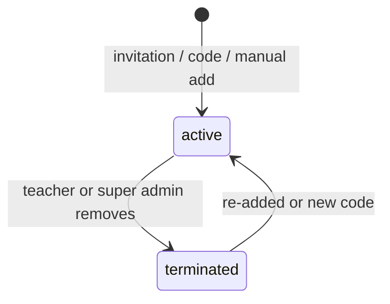
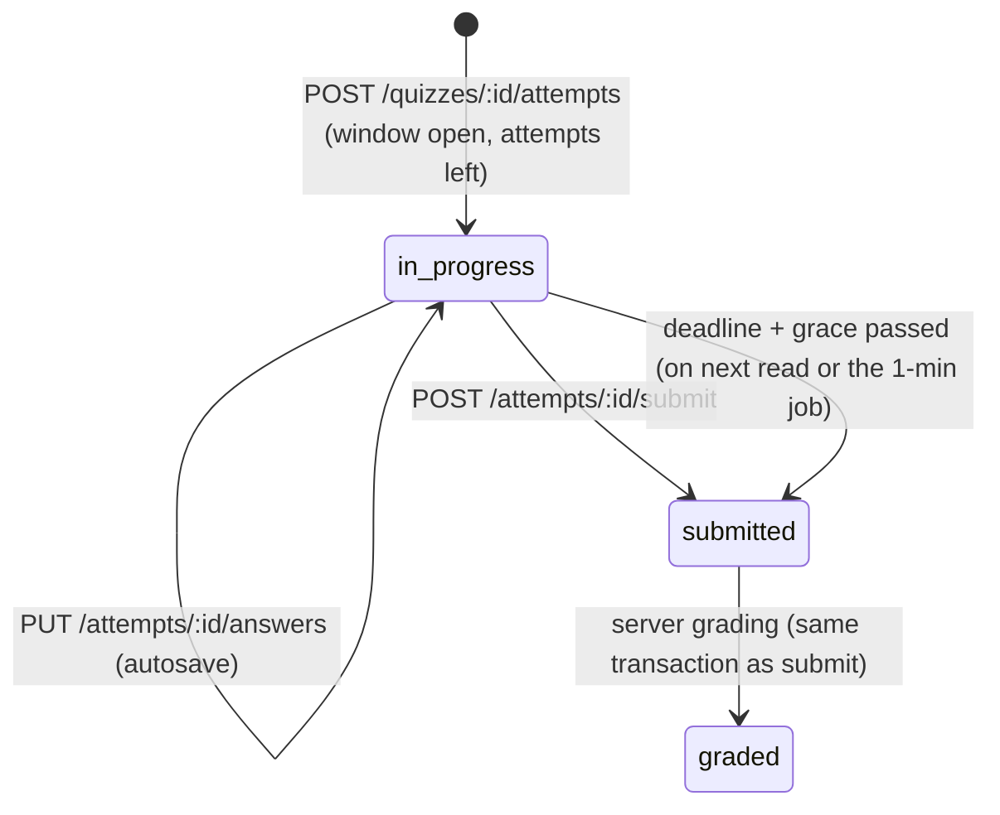
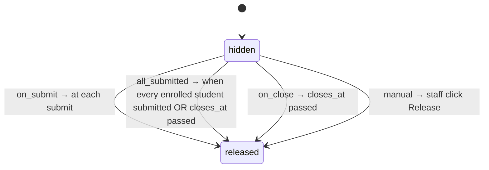

# Business flows

Steps marked 10R.x are built in Phase 10R of [../tasks/todo.md](../tasks/todo.md) ([ADR-013](adr/013-account-provisioning.md), [ADR-014](adr/014-guardian-consent.md)).

## 0. Creating accounts (10R.4, 10R.6)

An account (`users`), a place in an academy (`memberships`) and access to a course (`enrollments`) are three separate records. One request may create all three in one transaction, but each keeps its own rules. Both ways of creating accounts go through one `ProvisioningService`.

| Who | May create (direct or invitation) | Where |
|---|---|---|
| Super admin | teacher, assistant, student | admin host, any tenant |
| Teacher | assistant, student | own tenant |
| Assistant | student | own tenant |

Any other combination is 403 `ROLE_FORBIDDEN`. Nobody can create a super admin over HTTP (bootstrap only, [05 §1c](05-auth-devices.md)).

**Direct.** The creator sends name, email, password and (students) `isMinor`, optional `courseIds` and `requirePasswordChange` (default true). One transaction: check the role → the email must be new (teacher and assistant get 409 `USE_INVITATION` for an existing account; the super admin links it instead, without touching its password, profile or other memberships) → hash the password → `users` (`active`, `email_verified` false, `must_change_password` true for staff, `requirePasswordChange` for students) → membership (409 `MEMBERSHIP_ALREADY_EXISTS` if the person is already in the tenant) → enrollments → audit `member.create` (no password). No email is sent. An existing account linked to its first staff role gets `must_change_password` too.

**Invitation.** See §1. One email; the recipient sets their own password; accepting proves the mailbox.

## 1. Invitation (any role, new or existing account)

```mermaid
sequenceDiagram
  participant T as Super admin / teacher / assistant
  participant API
  participant S as Invited person
  T->>API: POST /invitations {email, role, courseIds}
  API->>API: token = 32 random bytes; store sha256 + expires_at (72h)
  API->>S: one email (Resend, role-aware): link /join?token=…
  S->>API: GET /invitations/check?token (validates only, does not consume)
  alt email has no account
    S->>API: POST /register {token, name, password, isMinor?, guardian?}
  else account exists, signed in
    S->>API: POST /invitations/accept {token}
  else account exists, cannot sign in yet (pending)
    S->>API: POST /invitations/accept-with-password {token, password}
  end
  API->>API: one transaction: mark redeemed (WHERE redeemed_at IS NULL), create user if new, mark email verified, membership with the invited role, enrollments
  API-->>S: sign in → (students) device bound
```

- GET never consumes (email scanners open links).
- The registered or signed-in email must equal the invited email.
- `role` (10R.6): the super admin may invite any role, the teacher assistants and students, the assistant students. Course grants are for students only. One open invitation per email per tenant (`INVITATION_ALREADY_EXISTS`).
- Accepting verifies the email: a new account is created verified, an existing one becomes verified, and a `pending` one becomes `active`. Accepting with a password (`/invitations/accept-with-password`, no session) checks the account's own password, needs the emailed token on every try and is limited to 10 per hour per IP ([05 §10](05-auth-devices.md)), so the invitation never replaces the password.
- A staff invitation needs a 12-character password at `/register`; an existing account accepting its first staff role must change its password before acting as staff (FR-A09).
- The frontend removes the token from the URL after use.

## 2. Access code

**Generate:** teacher picks a course and a count (max 500 per batch) → API creates codes `XXXX-XXXX-XXXX` (Crockford base32, 60 bits), stores HMAC hashes, returns the plain codes **once** as CSV. A lost CSV means revoking the batch and generating a new one.

**Redeem (new student):** `POST /register-with-code {code, email, name, password, isMinor, guardian?}` → one transaction: claim the code (`UPDATE … SET redeemed_at = now() WHERE code_hash = $1 AND redeemed_at IS NULL AND revoked_at IS NULL RETURNING …`), create user (`pending` until the email is verified, 10R.3), membership, enrollment → verification email (and a guardian consent request for a minor who named a guardian, 10R.7).

**Redeem (existing student):** logged in, `POST /codes/redeem {code}` → claim, create membership if missing, create or reactivate enrollment. No consent step: the person's consent, if any, already applies, and the access gate (§10) decides.

Codes are never emailed (FR-E02): the full code exists only in the CSV returned at creation. To give one known person a course, staff use an invitation with courses (new account) or a manual enrollment (existing account).

Shortcut: a code is consumed at registration even if the email is never verified. The teacher can resend verification. Revisit if this causes support load.

## 3. Enrollment lifecycle



On terminate: SSE `enrollment_terminated`, the student loses access at once, progress and grades stay, audit entry written.

## 4. Upload

1. `POST /uploads {fileName, mimeType, size, purpose}` → checks role, MIME allow-list, size limit → creates `media_assets` (pending, key `tenants/{tenantId}/{assetId}`) → returns a presigned PUT (15 min). The URL signs `Content-Type` and `Content-Length`, so R2 refuses another type or size.
2. Browser PUTs to R2.
3. `POST /uploads/:assetId/confirm` → `HEAD` object, check size and type → `ready` and an audit entry (`media.upload`). A mismatch marks the asset `failed` and deletes the file. Confirming twice is safe.
4. Staff attach the asset to a content item.

A daily job deletes assets stuck in `pending` for more than 24 hours.

Allowed types and size limits (`UPLOAD_LIMITS` in `packages/shared`): PDF/DOCX/PPTX 100 MB, JPEG/PNG/WebP 10 MB, MP4 5 GB (single presigned PUT). No SVG or GIF. `purpose: "public"` (logos, thumbnails) accepts images only and uses the public bucket; `"content"` uses the private bucket.

## 5. Viewing content

`GET /content-items/:id/access` → guards + active enrollment + course published or archived + item and every item above it published → returns signed URLs (documents 5 min, video 4 h) plus the watermark text for videos. View-only files get no download URL; DOCX/PPTX are download-only; videos never get a download URL. When a URL expires, the client asks again and every check runs again. Details: [designs/phase-7.6](designs/phase-7.6-content-access-api.md). A view-only PDF is rendered in PDF.js with no download button. That is not true protection, which [09-security.md](09-security.md) explains.

## 6. Exam attempt



- **Start:** server picks questions (manual list or random from banks), shuffles if set, stores a `snapshot` with option IDs, sets `deadline_at = min(started_at + duration + extra_time, closes_at)`.
- **Student payload:** from the snapshot with `is_correct` and explanations removed.
- **Autosave:** each answer is upserted, rejected after `deadline_at + grace_sec`.
- **Grading:** single = exact option; multiple = exact set (no partial marks in MVP); true/false = exact.
- **Navigation `linear`:** the server rejects answers to questions before the current index.

## 7. Grade and review release



- Visibility is computed on read (`grades_released_at` set, or the rule is met now). The job only sends "grades released" notifications.
- Review is separate: `review_mode` decides what is shown, `review_release_at` decides when (default: `closes_at`). Before release, students see at most their score.

## 8. Tenant pause (super admin)

1. Super admin picks roles to pause (`teacher`, `assistant`, `student`, any mix) or suspends individual memberships or users.
2. API updates `paused_roles` / statuses and deletes the matching sessions in one transaction.
3. Affected users get `TENANT_PAUSED` or `NO_ACCESS` on their next request.
4. Unpausing restores access. No data changes.

## 9. Tenant deletion

Soft delete → site returns 404 → after 30 days the purge job deletes the R2 prefix `tenants/{id}/` and all tenant rows. Before deleting, the super admin can export a ZIP (CSV of students, enrollments, grades, payments). The export is a later task.

## 10. Guardian consent (10R.7)

Consent belongs to the person (`users.is_minor` and the global `guardian_consents` table), is recorded once and opens every academy the student is in (FR-A06, [ADR-014](adr/014-guardian-consent.md)).

**Electronic:**
1. The student (for themself) or staff (for a student of their tenant) give the guardian's name, relationship and email. The guardian email must differ from the student's. At most 3 requests an hour per student.
2. The API stores one `pending` record with a token (32 random bytes, stored as sha256, valid 7 days) and Resend sends the guardian one email. A new request rotates the token on the same record.
3. The guardian opens the link: `GET /guardian-consent/check?token` shows the student, the academy and the policy version, and consumes nothing.
4. `POST /guardian-consent/confirm {token, guardianName, relationship, agree}` → `given`, with method, time, policy version, IP and browser.

This proves that someone who controls the guardian's mailbox agreed. It does not prove that person is the parent; the lawyer decides whether it is enough (step 12.6a).

**Offline:** a teacher, assistant or super admin who has seen a signed form records guardian name, relationship, date obtained and a document reference (for example "Signed form #114, office file 2026"), with optional notes. No image or scan is stored; the academy keeps the paper under its own retention. Recorded with who did it and in which tenant; audited.

**Withdrawal:** staff or the super admin record it when the guardian asks → `withdrawn` → access closes everywhere. A new consent can be recorded later.

**Access gate:** if `is_minor` is true and there is no `given` consent (old checkbox records do not count), the API answers 403 `GUARDIAN_CONSENT_REQUIRED` on the course tree, content links, progress, lesson Q&A, starting an attempt, and every later attempt route (view, answer, list answers, submit, review). A link handed out before a withdrawal still works until it expires (documents 5 min, videos 4 h). An attempt left open after a withdrawal is finished by the deadline job. Code redemption and invitations never ask for consent; the gate decides.

**Who sees what:** staff of any academy the student is in see the status, method and date. Guardian details are shown only to the super admin and to the academy that recorded them.

**Minor status:** set when the account is created (direct creation, registration). After that only the super admin changes it, in either direction, because it is shared by every academy.

**Old records:** `memberships.guardian_consent_at` values came from the student's own checkbox. Migration 10R.7 copies each into `guardian_consents` as `legacy_checkbox` (kept as history, not counted as consent) and sets `is_minor` for those people. The old column stays, no longer written.

## 11. Tenant staff (10R.5)

- A tenant has one or more teachers and any number of assistants, all as `memberships` rows; a person may be teacher in one tenant and assistant in another, but has one role per tenant.
- The super admin lists (`?role=&status=&q=&cursor=&limit=`), adds (§0), re-roles (teacher ⇄ assistant only), suspends and removes staff in any tenant. Teachers add and remove assistants in their own tenant. Assistants manage no staff.
- **Last active teacher:** a tenant always keeps one teacher whose membership and user are both active. Removing, demoting or suspending that membership, or suspending that user globally, returns 409 `LAST_TEACHER`. Each of those writes first locks the affected tenant rows (`SELECT … FOR UPDATE`), so two parallel removals cannot both pass. To replace the last teacher, add the new one first. Pausing the teacher role stays allowed: it is a temporary block, not a removal.
- Removing a staff member ends their staff sessions only when it was their last staff role (step 10.3 rule).
