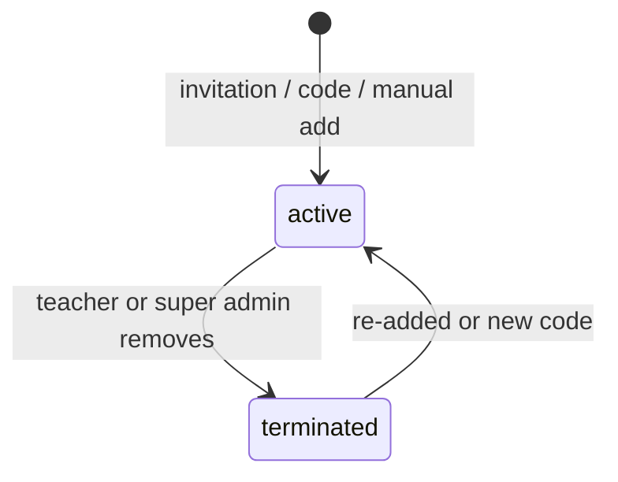
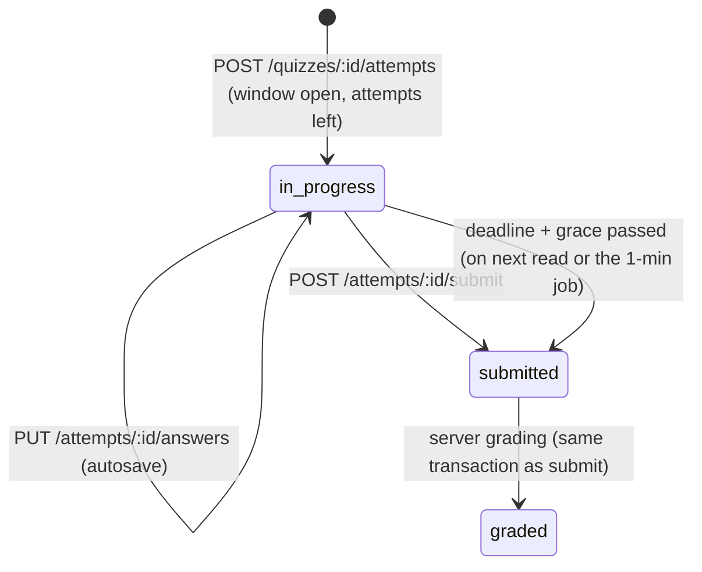
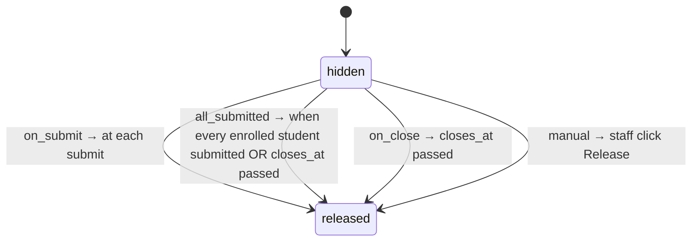

# Business flows

## 1. Invitation (new or existing student)

```mermaid
sequenceDiagram
  participant T as Teacher
  participant API
  participant S as Student
  T->>API: POST /invitations {email, courseIds}
  API->>API: token = 32 random bytes; store sha256 + expires_at (72h)
  API->>S: email link /join?token=…
  S->>API: GET /invitations/check?token (validates only, does not consume)
  alt email has no user
    S->>API: POST /register {token, name, password, guardianConsent}
  else user exists
    S->>API: POST /invitations/accept {token} (after login)
  end
  API->>API: one transaction: mark redeemed (WHERE redeemed_at IS NULL), create user if new, membership, enrollments
  API-->>S: verify email (new user) → login → device bound
```

- GET never consumes (email scanners open links).
- The registered email must equal the invited email.
- The frontend removes the token from the URL after use.

## 2. Access code

**Generate:** teacher picks a course and a count (max 500 per batch) → API creates codes `XXXX-XXXX-XXXX` (Crockford base32, 60 bits), stores HMAC hashes, returns the plain codes **once** as CSV. A lost CSV means revoking the batch and generating a new one.

**Redeem (new student):** `POST /register-with-code {code, email, name, password, guardianConsent}` → one transaction: claim the code (`UPDATE … SET redeemed_at = now() WHERE code_hash = $1 AND redeemed_at IS NULL AND revoked_at IS NULL RETURNING …`), create user, membership, enrollment → verification email.

**Redeem (existing student):** logged in, `POST /codes/redeem {code}` → claim, create membership if missing, create or reactivate enrollment.

Shortcut: a code is consumed at registration even if the email is never verified. The teacher can resend verification. Revisit if this causes support load.

## 3. Enrollment lifecycle



On terminate: SSE `enrollment_terminated`, the student loses access at once, progress and grades stay, audit entry written.

## 4. Upload

1. `POST /uploads {fileName, mimeType, size, purpose}` → checks role, MIME allow-list, size limit → creates `media_assets` (pending) → returns a presigned PUT (15 min).
2. Browser PUTs to R2.
3. `POST /uploads/:assetId/confirm` → `HEAD` object, check size and type → `ready`.
4. Staff attach the asset to a content item.

A daily job deletes assets stuck in `pending` for more than 24 hours.

Size limits: PDF/DOCX/PPTX 100 MB, images 10 MB, MP4 5 GB (single presigned PUT).

## 5. Viewing content

`GET /content/:itemId/access` → guards + active enrollment + item published + course published → returns a signed URL (documents 5 min, video 4 h) plus the watermark text for videos. A view-only PDF is rendered in PDF.js with no download button. That is not true protection, which [09-security.md](09-security.md) explains.

## 6. Exam attempt



- **Start:** server picks questions (manual list or random from banks), shuffles if set, stores a `snapshot` with option IDs, sets `deadline_at = min(started_at + duration + extra_time, closes_at)`.
- **Student payload:** from the snapshot with `is_correct` and explanations removed.
- **Autosave:** each answer is upserted, rejected after `deadline_at + grace_sec`.
- **Grading:** single = exact option; multiple = exact set (no partial marks in MVP); true/false = exact.
- **Navigation `linear`:** the server rejects answers to questions before the current index.

## 7. Grade and review release



- Visibility is computed on read (`grades_released_at` set, or the rule is met now). The job only sends "grades released" notifications.
- Review is separate: `review_mode` decides what is shown, `review_release_at` decides when (default: `closes_at`). Before release, students see at most their score.

## 8. Tenant pause (super admin)

1. Super admin picks roles to pause (`teacher`, `assistant`, `student`, any mix) or suspends individual memberships or users.
2. API updates `paused_roles` / statuses and deletes the matching sessions in one transaction.
3. Affected users get `TENANT_PAUSED` or `NO_ACCESS` on their next request.
4. Unpausing restores access. No data changes.

## 9. Tenant deletion

Soft delete → site returns 404 → after 30 days the purge job deletes the R2 prefix `tenants/{id}/` and all tenant rows. Before deleting, the super admin can export a ZIP (CSV of students, enrollments, grades, payments). The export is a later task.
